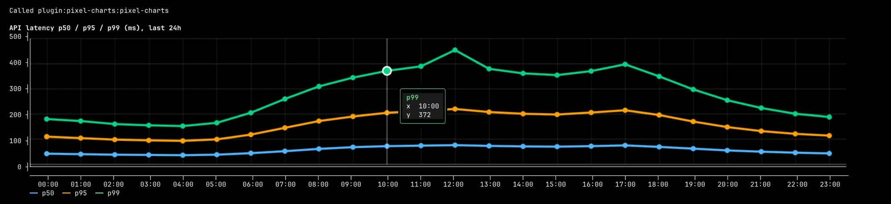
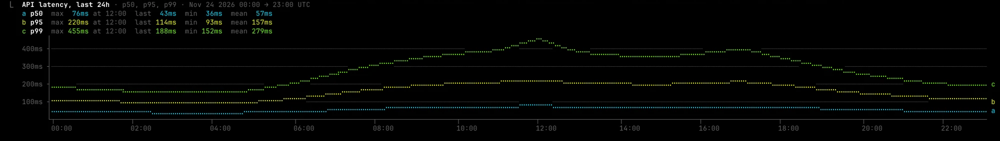

# claude-pixel-charts

A Claude Code plugin that draws real pixel charts in the transcript, with the
kitty graphics protocol, instead of ASCII.



The same data drawn by the built-in easel plugin, in terminal cells:



- **`draw_chart` tool**: Claude calls it for bar, line and scatter charts when
  numbers read better as a chart than as a table.
- **Auto charts**: Grafana `query_prometheus` range results get a line chart
  under the tool row, with no extra call.
- **Hover**: in the fullscreen layout, hovering a chart shows a crosshair and
  the nearest value.
- Light and dark palettes follow the Claude Code theme; up to 6 series for
  `draw_chart`, 20 for auto charts.

## Install

At the prompt of a Claude Code session:

```text
/plugin install pixel-charts --marketplace skeetmtp/claude-pixel-charts
```

From a shell:

```bash
claude plugin install pixel-charts --marketplace skeetmtp/claude-pixel-charts
```

From a local clone, for development:

```bash
claude --plugin-dir ./claude-pixel-charts
```

Then run `/pixel-charts-demo` to draw one sample of each chart type.

## Terminals

Pixels need kitty, Ghostty, or iTerm2 3.5+ in fullscreen rendering. Elsewhere,
and inside tmux, pixel-charts draws nothing and withdraws `draw_chart`, so the
built-in easel plugin's auto charts (keep "Auto charts" on in `/config`) and
its `chart` tool take over. Where pixel-charts draws a Prometheus chart, easel
is not handed that result, so each query gets one chart.

`/pixel-charts-status` shows the mode the session resolved.

| Variable | Effect |
| --- | --- |
| `PIXEL_CHARTS_MODE=image\|raster` | Force pixels, or a half-block cell raster |
| `PIXEL_CHARTS_AUTO=off` | Turn off Grafana auto charts |

## Layout

- `server/server.mjs`: stdio MCP server for `draw_chart`, plain Node, no
  dependencies.
- `hooks/register.tsx`: the mod that draws tool results as charts.
- `hooks/chart.ts`: the RGBA rasterizer (axes, lines, bars, points).
- `hooks/prometheus.ts`: Prometheus range results to chart specs.
- `hooks/hover.tsx`: the pointer layer for hover tooltips.
- `tests/`: `claude plugin test .`
